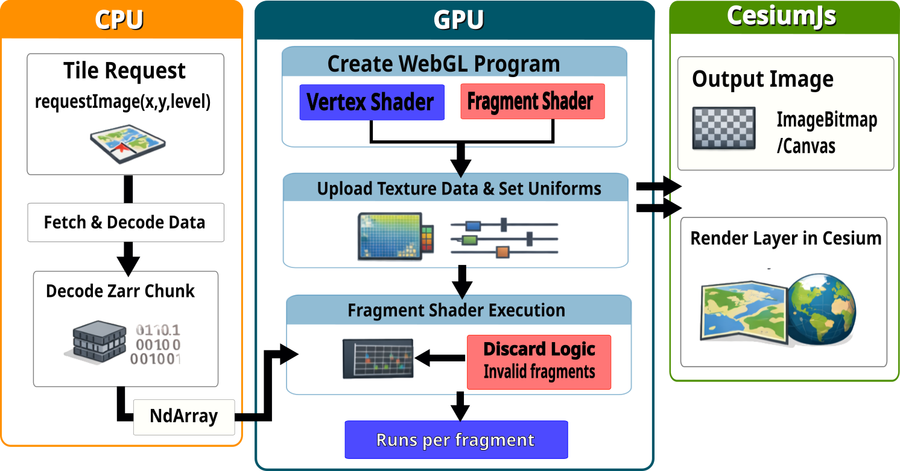

# Summary

Ocean and atmospheric scientists work with datasets that vary across latitude, longitude, depth, and time. Although these data can be stored efficiently as multidimensional arrays, making them explorable on an interactive map often requires a separate service that transforms the data into images. This adds infrastructure and can limit users to a set of predefined views.

`Zarr-Cesium` is an open-source TypeScript library for visualizing cloud-hosted Zarr arrays [@zarr] in CesiumJS [@cesiumjs]. It reads relevant chunks in the browser and displays scalar fields on a globe, GPU-rendered horizontal and vertical sections through three-dimensional datasets, arbitrary vertical cross-sections, and animated vector fields. Users can change variables, times, depths, and visual styling while working with the underlying multidimensional data rather than a pre-rendered collection of map images. The library supports Zarr v2 and v3, common Climate and Forecast (CF) metadata conventions [@cfconventions], suitable single-scale and multiscale arrays, and geographic and Web Mercator coordinate reference systems. It is intended for developers building research-oriented, interactive applications, particularly in oceanography, meteorology, and environmental data dissemination.

# Statement of need

Environmental simulations and observations frequently describe processes that evolve in several dimensions. Ocean temperature, for example, may change substantially with depth, while ocean currents have distinct horizontal components and temporal variability. Large reanalyses and climate-model archives illustrate both the scale and scientific importance of these data [@era5; @cmip6]. Zarr enables chunked access to selected portions of such arrays without retrieving an entire dataset [@zarr; @abernathey2021cloud]. However, efficient storage alone does not provide a way to explore these data in a web-based geographical context.

A common publication workflow serves raster images through a Web Map Service (WMS) or another tile endpoint. These architectures remain useful, especially for centralized processing, access control, or broad client compatibility, but their deployment and maintenance can be disproportionate for projects already distributing suitably structured arrays from object storage. Pre-generating images also introduces derived products that must be managed when datasets or presentation choices change.

`Zarr-Cesium` addresses developers of environmental data portals, research infrastructures, and exploratory scientific tools who need interactive geographic views of multiple dimensions without maintaining a dedicated rasterization service. Its objective is not to replace numerical analysis tools, but to connect cloud-native scientific arrays to interactive 2D and 3D visualization and exploratory queries for points, time series, vertical profiles, and transects.

# State of the field

Several established tools cover complementary parts of this workflow. GeoServer and ncWMS provide server-managed map services for geospatial and multidimensional environmental data [@geoserver; @blower2013ncwms]. TiTiler and related xarray-based services generate map tiles from cloud-hosted raster data or multidimensional arrays [@titiler; @titilerxarray; @xpublishtiles]. These are appropriate where server-side rendering, transformation, and centralized control are desired; they do not eliminate the rendering service itself.

Other tools bring the processing closer to the client. Zarrita provides JavaScript access to Zarr arrays [@zarrita], while CesiumJS supplies a mature geographical rendering engine [@cesiumjs]. Neither alone supplies the combined workflow of resolving multidimensional scientific coordinates, selecting array subsets from a geographic view, and rendering those subsets as Cesium imagery and 3D sections. Browser-based Zarr visualization projects also exist, including the CarbonPlan `zarr-layer` and Development Seed `deck.gl-raster`, but target different rendering environments or narrower visualization tasks [@carbonplanzarrlayer][@developmentseeddeckglraster].

We developed `Zarr-Cesium` as an integration layer rather than implementing a new data format, array reader, or 3D globe. It builds on Zarrita, CesiumJS, and reusable Zarr mapping components. The distinctive contribution is the coordinated handling of scientific dimensions, selective retrieval, visualization-specific data preparation, and Cesium rendering through a consistent library interface. This makes it possible to add multidimensional Zarr visualization to an existing Cesium application without first designing and operating a custom tile API.

# Software design

Zarr-Cesium separates data access, scientific coordinate interpretation, and CesiumJS rendering. Three public providers offer complementary visualization modes: `ZarrLayerProvider` renders two-dimensional scalar fields as imagery; `ZarrCubeProvider` displays geographic horizontal and vertical sections through three-dimensional scalar arrays; and `ZarrCubeVelocityProvider` animates vector fields using particle advection. Rather than implementing a new array reader or geographic engine, the package combines Zarr-compatible data access with Cesium imagery layers and scene primitives.

The two-dimensional processing pathway shares data selection and tiling logic with Leaflet [@leaflet] and OpenLayers [@openlayers] integrations through `zarr-maps-tiling` [@zarrmapstiling]. The separate `zarr-maps-colormap` package supplies reusable palette definitions and colour-ramp utilities [@zarrmapscolormap]. For three-dimensional datasets, both cube providers use the exported, non-rendering `ZarrCubeDataProvider` to resolve dimensions and selectors, select geographic bounds, load a data subset, and normalize coordinate ordering. Separating this loader from scene rendering allows applications to use the selected array and its coordinates without relying on Cesium-specific visualization classes.

The overall architecture is summarised in \autoref{fig:architecture}, showing how Zarr-compatible stores and shared data-access components feed the three Cesium-facing visualization providers. This separation allows data retrieval and scientific coordinate handling to be reused independently of individual rendering modes.

The providers read Zarr v2 and v3 arrays through Zarrita-compatible readable stores [@zarrita]. They can access publicly hosted HTTP datasets, custom readable stores such as Icechunk, and restricted stores through request credentials, per-object header transformations, proxies, or signed URLs. Support for CF-style coordinate metadata [@cfconventions], configurable dimension names, and coordinate reference systems EPSG:4326 and EPSG:3857 connects array indices to geographic positions. Single-scale data and GeoZarr multiscale layouts [@geozarr] are supported, although access patterns and performance depend on data layout and the chosen resolution. Scientific query methods expose sampled values, time series, vertical profiles, and transects in addition to the visual layers.

For two-dimensional imagery, WebGL textures and shader-driven colour mapping separate many styling operations from data retrieval. Zarr-Cesium v0.4.0 extends GPU-based rendering to scalar cube sections. Its `CubeGpuRenderer` retains cube values and colour mapping on the GPU and draws horizontal, latitude, and longitude sections using Cesium primitives. It also supports user-defined vertical cross-sections between two geographic coordinates, including projected EPSG:3857 datasets. The renderer updates selected sections, colour scales, opacity, and vertical layout without requiring a new Zarr read when the loaded subset is unchanged. If the cube exceeds the device's supported texture size, `ZarrCubeProvider` uses a CPU-based compatibility renderer that creates RGBA textures. This fallback preserves the principal slice APIs but does not support arbitrary two-point cross-sections. Vector-field animation uses a Cesium wind-layer implementation adapted to three-dimensional cube data [@cesiumwindlayer].

For tiled scalar imagery, the CPU-to-GPU processing sequence is illustrated in \autoref{fig:tile-workflow}. After a tile request, selected Zarr chunks are fetched and decoded on the CPU; numerical values and rendering parameters are then supplied to WebGL, which applies the shader-based colour mapping and produces the image consumed by CesiumJS. This figure describes the two-dimensional tile pathway, not the separate GPU cube renderer.

These choices move substantial data selection and rendering work into the browser, making it possible to deploy a scientific viewer as static application assets alongside an accessible Zarr store without operating a dedicated raster tile server. They also impose constraints: source data must be chunked appropriately, browser memory and GPU texture limits bound the size of interactive cubes, HTTP access must permit cross-origin requests, and very large datasets may benefit from server-assisted processing. GPU-rendered cube slices are not equivalent to full volumetric ray casting; they provide interactive sections through a loaded subset.

# Research impact statement

`Zarr-Cesium` was developed for the AtlantiS environmental visualization platform at the National Oceanography Centre. In that application, it provides browser-based views of multidimensional oceanographic and related environmental datasets in a geographic context [@atlantisvis]. This constitutes an application within a research infrastructure project, rather than evidence of independent adoption.

Independent integration is documented in GeoLibre, an open-source geospatial application maintained outside the original development team. GeoLibre declares `zarr-cesium` as a dependency and uses `ZarrLayerProvider` to display Zarr data on its Cesium globe [@geolibre]. Its maintenance notes describe the integration, compatibility tests, and limitations concerning colormap options and dimension aliases [@geolibremaintenance]. These details offer evidence that a downstream developer has exercised the library's interfaces and identify concrete opportunities for upstream improvements. They do not, on their own, establish a peer-reviewed scientific result produced with the software.

The library is also described in Development Seed's *Datacube Guide* alongside other approaches to visualizing cloud-native arrays [@datacubeguide]. This independent technical documentation demonstrates recognition and discoverability, but is not counted here as a separate scientific deployment. Together, AtlantiS and GeoLibre demonstrate research-oriented application and external software uptake.

# AI usage disclosure

Generative AI tools, including OpenAI ChatGPT (GPT-5.6 and GPT-6), were used to assist with the organisation, editing, and refinement of this manuscript, as well as the development and integration of GPU-based rendering for three-dimensional cube visualisation. All software architecture decisions, technical implementations, and scientific claims were reviewed and validated by the author. Any AI-assisted code was manually reviewed, tested, and verified before being incorporated into the software.

# Acknowledgements

The author acknowledges the CesiumJS, Zarrita, and related open-source communities. The project was developed in the context of the National Oceanography Centre's AtlantiS initiative. JASMIN provided storage and testing infrastructure.

# References
